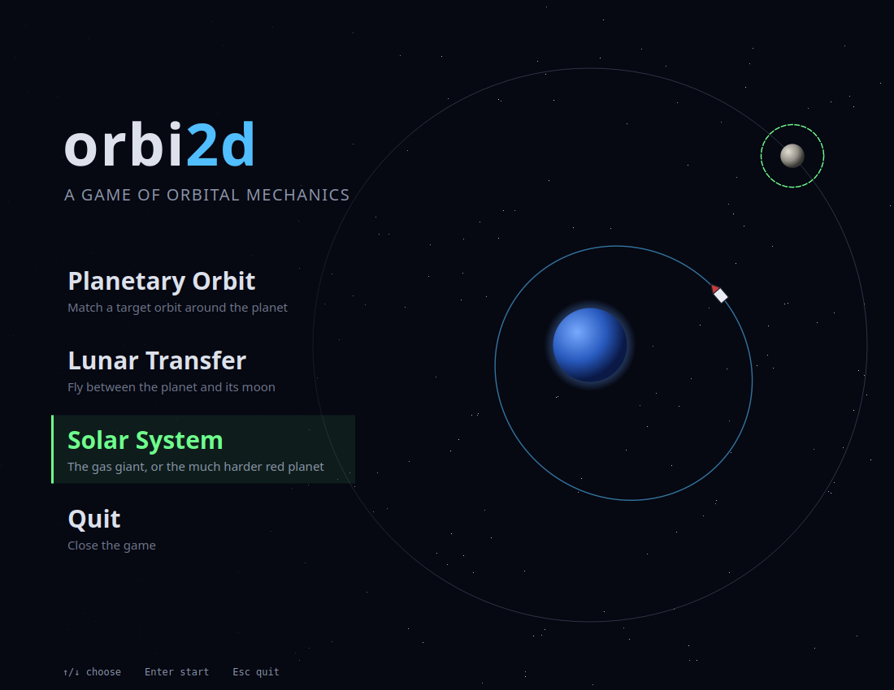

# orbi2d

A 2D orbital-mechanics game in Python + Qt (PySide6). Your rocket starts on a
random orbit. Put it on the dashed green target orbit, to within 2% (the
largest radial gap between the two curves, relative to the target).

There are two modes:

- **Single planet** (default): start and target orbits are both around the
  planet.
- **Planet + moon**: a moon circles the planet. You start around one of them
  and the target orbit is around the other, so you have to fly from the
  planet to the moon or from the moon back to the planet.

This started as a vibe-coding project. The first few prompts are documented
for posterity in [claude_session.txt](https://github.com/PiRK/orbi2d/blob/master/claude_session.txt).

## Install and run

    pip install orbi2d
    orbi2d

From a clone of this repository:

    pip install -r requirements.txt
    python -m orbi2d                # single-planet mode
    python -m orbi2d --mode moon    # planet + moon mode
    python -m orbi2d --seed 42      # replay a given level (works with both modes)

## Controls

| Key            | Action                                           |
|----------------|--------------------------------------------------|
| ← / →          | Side thrusters: rotate the ship (orientation only) |
| Space (or ↑)   | Main engine                                      |
| Shift (held)   | Fine control: 10% thrust, slower rotation        |
| 1–6            | Time warp presets ×0.25 / ×0.5 / ×1 / ×2 / ×4 / ×8 |
| + / −          | Time warp ×1.25 / ÷1.25 (range ×0.1 – ×16)       |
| P              | Pause                                            |
| R / N          | New random level (Enter also works after a game ends) |
| M              | Switch mode (single planet ↔ planet + moon)      |
| V              | Moon mode: toggle the whole-system view          |
| H              | Toggle help                                      |
| Esc / Q        | Quit                                             |

The yellow circle next to the ship marks the **prograde** direction (where the
ship is moving). The red ✕ marks **retrograde**. Pe/Ap mark periapsis and
apoapsis.

The game starts at ×0.5 time warp. Turning always happens in real time, but
orbital motion and engine thrust follow the warp. Slow motion therefore also
makes burns finer: at ×0.25 a tap on Space changes your speed 4× less.

## Planet + moon mode

- The moon moves on a circular orbit, so you have to time your departure: a
  transfer only works if the moon is there when you arrive.
- The dotted circle around the moon is its **sphere of influence** (SOI).
  Inside it only the moon's gravity acts on the rocket; outside it only the
  planet's does. Your current orbit is drawn around whichever body you are
  orbiting.
- When your trajectory will cross the SOI, the game shows the prediction in
  purple: the crossing point (◇), where the moon will be at that moment, and
  your orbit after the crossing. The top-right corner shows the time until the
  encounter.
- Typical trip to the moon: burn prograde until the purple prediction shows an
  encounter, coast in, then burn retrograde near the moon's periapsis to be
  captured, and fine-tune. To go back, burn prograde around the moon until you
  leave its SOI.
- While you orbit the moon the camera zooms in on it. Press V for the whole
  system.

## Physics

- The rocket and planet form a two-body Kepler system. Coasting uses the
  analytic universal-variable solution, so the ship follows the drawn conic
  exactly with no numerical drift. This works for ellipses, parabolas and
  hyperbolas.
- The main engine is modelled as a finite burn. Each frame is split into short
  sub-steps, and each sub-step uses kick, exact Kepler coast, kick. After each
  frame the osculating orbit is recomputed from the state vector and redrawn.
  So a burn in any direction at any point of the orbit changes the orbit the
  way it would in reality. For example, a prograde burn at one apsis raises the
  other apsis, and a radial burn rotates the line of apsides.
- In planet + moon mode the game uses *patched conics*: each body has a
  sphere of influence, `r_SOI = d · (m_moon / m_planet)^0.4`. When the rocket
  crosses its edge, the position and velocity are converted to the other
  body's frame and the rocket continues on an exact conic around that body.
- You win when the engine is off, you are orbiting the target's body, and your
  orbit is within the tolerance of the target. Only the shape of the orbit counts, not the direction of travel.
  You lose if you hit the planet or escape.

Tuning constants are at the top of `orbi2d/game.py`.

## Tests

    python -m pytest

## License

MIT. See [LICENSE](https://github.com/PiRK/orbi2d/blob/master/LICENSE).
